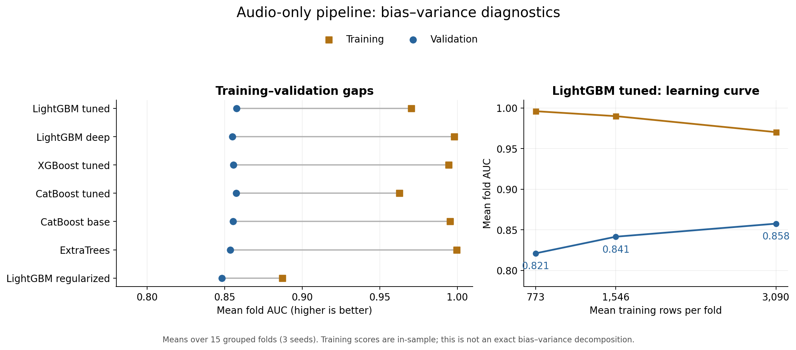

# Bias–variance diagnostics — November 1, 2026

The current pipeline has substantial training–validation gaps. Larger training
pools improve validation performance, and averaging predictions across seeds
helps. These are signs of overfitting and sensitivity to the available training
data. They do not establish a numerical decomposition of bias, variance, and
irreducible error, or prove that approximation bias is negligible.



## Training versus validation

Each entry is the unweighted mean of 15 fold scores: five grouped folds across
seeds 0, 1, and 2. Track URI groups never cross a fold boundary. These fold means
differ slightly from AUC calculated on pooled out-of-fold predictions.

| Model | Training AUC | Validation AUC | Gap |
|---|---:|---:|---:|
| LightGBM tuned | 0.970302 | 0.857540 | 0.112762 |
| LightGBM deep | 0.997985 | 0.854931 | 0.143054 |
| XGBoost tuned | 0.994456 | 0.855518 | 0.138938 |
| CatBoost tuned | 0.962598 | 0.857309 | 0.105290 |
| CatBoost base | 0.995143 | 0.855453 | 0.139690 |
| ExtraTrees | 0.999488 | 0.853655 | 0.145833 |
| LightGBM regularization probe | 0.887172 | 0.848076 | 0.039095 |

Deep LightGBM, base CatBoost, XGBoost, and ExtraTrees nearly perfectly rank
training examples, but do not outperform tuned LightGBM or tuned CatBoost on
validation data in this diagnostic. The models are not failing to fit the
training set. Log loss and Brier score also show substantial generalization
gaps; full values are in `model_summary.csv`.

## More training data helps in the observed range

This learning curve uses tuned LightGBM, the same validation folds, and nested
group-preserving training subsets. Label-derived features are recomputed using
only each subset's labels, excluding both the validation labels and labels of
unused training rows.

| Fraction of outer training pool | Mean training rows | Training AUC | Validation AUC | Validation log loss |
|---|---:|---:|---:|---:|
| 25% | 773 | 0.996084 | 0.821003 | 0.495297 |
| 50% | 1,546 | 0.990011 | 0.841461 | 0.462890 |
| 100% | 3,090 | 0.970302 | 0.857540 | 0.439557 |

Validation improves as more examples become available, while training performance
becomes less optimistic. The full pool beats both smaller pools on all 15 matched
folds. This supports a data-limited generalization interpretation for this
pipeline; it does not quantify the benefit of acquiring data beyond this range.
The curve measures the whole pipeline, including the improvement in availability
of label-derived date features as the training pool grows.

## A smaller gap is not automatically better

One prespecified regularization probe changed LightGBM from 22 to 10 leaves,
maximum depth from 6 to 4, minimum child samples from 11 to 60, and L2 penalty
from approximately 0.0029 to 10. All other parameters were held fixed.

This reduced the AUC gap from 0.112762 to 0.039095 but reduced validation AUC
by 0.009464. It lost on every matched fold (0 wins out of 15); validation log
loss also worsened, from 0.439557 to 0.453834. The tested setting sacrificed too
much useful flexibility. Because four controls changed together, this experiment
does not identify which control caused the decrease or rule out gentler
regularization. No production hyperparameters were changed.

## Prediction stability and averaging

Across three seeds, the existing models' pooled OOF AUC standard deviations range
from 0.000447 (tuned CatBoost) to 0.002137 (base CatBoost). Average per-track
probability standard deviations range from 0.034503 to 0.049988. A nearly stable
aggregate AUC can therefore coexist with meaningful changes in individual
predictions. This variability combines changes in training partitions and model
randomness; it is not an estimate of all theoretical prediction variance.

For tuned LightGBM, mean per-seed pooled OOF AUC is 0.857036, while AUC of the
three-seed mean prediction is 0.860772 (+0.003735). Every existing model benefits
from seed averaging in this run. These are different aggregation operations,
both explicitly recorded in `prediction_stability.csv`. The existing final
pipeline already averages across seeds; this confirms the value of that practice
rather than establishing a new improvement over the current blend.

## Practical next step

Retain the current tuned baseline and seed averaging. Test a small, controlled
set of milder complexity/regularization adjustments, changing one control at a
time and keeping grouped validation fixed. Feature simplification, including
PCA specifically for KNN, remains a separate hypothesis to test. More training
data is promising based on the learning curve, but a performance gain beyond
the observed range is not established. This analysis does not justify increasing
model capacity merely to improve training scores.

## Scope and limitations

- AUC is a ranking metric; the train–validation AUC gap is not a variance term
  in a squared-error bias–variance identity. Bayes error and true bias are unknown.
- Training scores are in-sample on the actual training representation. Training
  date target encoding uses inner cross-fitting; training KNN excludes zero-distance
  neighbors. Validation features use the outer training pool. These representation
  differences can contribute to the observed gap.
- Existing label-free, transductive conventions are retained: global audio scaling,
  full-file URI multiplicity, and train-plus-test release-date counts. Learning-curve
  subsets vary access to training labels, not all access to unlabeled feature data.
- Folds and seeds reuse observations and are correlated; fold spread and seed spread
  are descriptive, not independent confidence intervals or significance tests.
- Existing parameters and features were selected on this dataset. These are
  exploratory CV diagnostics, not a new untouched test evaluation. No test labels
  or leaderboard feedback were used in this task.
- The weighted AUC columns retain the prior duplicate-prevalence adjustment;
  the tables above use ordinary AUC and should not be read as leaderboard estimates.

## Reproduce and inspect

From the repository root, using the environment recorded in
`final_pipeline/requirements-lock.txt`:

```powershell
.venv/Scripts/python.exe -m unittest discover -s final_pipeline -p test_bias_variance.py -v
.venv/Scripts/python.exe final_pipeline/analyze_bias_variance.py --seeds 0,1,2 --threads 6 --out final_pipeline/experiments/bias_variance_rerun
.venv/Scripts/python.exe final_pipeline/plot_bias_variance.py --results final_pipeline/experiments/bias_variance_rerun
.venv/Scripts/python.exe final_pipeline/verify_bias_variance.py
```

The verification command checks this recorded November 1 experiment; the analyzer
refuses to overwrite an existing result set. The run consists of 105 full-pool
fits and 30 reduced-pool fits. `run_metadata.json` records source hashes and the
starting commit; `run.log` records training output. Predictions, fold assignments,
fold metrics, seed metrics, paired comparisons, and aggregated tables are saved.

Three unit tests passed, including nested group sampling and invariance to changes
in excluded labels. Independent rank-sum AUC, direct Brier score, and clipped log
loss calculations agree with all 21 saved model/seed summaries. Use round-trip
CSV float parsing to preserve ties; exact zero probabilities require clipping
for log loss. All 75 non-ExtraTrees baseline fold AUCs match the previous audio-only
experiment to 1e-12. ExtraTrees differs by at most 0.000003721, which does not alter
the findings. Input/source hashes are unchanged. The figure was visually inspected.
See `validation.json` for the recorded check results.
