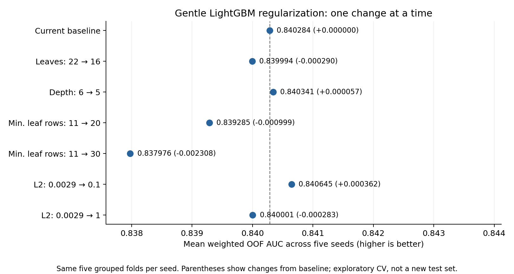

# Gentle LightGBM regularization — November 1, 2026

The best small change was increasing L2 (`reg_lambda`) from 0.002916 to 0.1.
Mean weighted out-of-fold AUC improved by 0.000362, with improvements on three
of five seeds. Replacing LightGBM in a fixed-weight blend gave only a 0.000068
weighted AUC improvement under the seed-averaged evaluation below. This is a
tentative candidate, not a demonstrated reliable improvement. Defaults remain
unchanged.



## Experiment

Each candidate changes exactly one parameter from `final_pipeline/tuned_lgb.json`.
All other parameters, audio-only KNN features, five grouped validation folds,
seeds 0–4, and model random seeds are identical. The primary selection metric was
declared before fitting: mean per-seed weighted OOF AUC, using the existing
duplicate-prevalence weights. This is 175 model fits (seven settings × five seeds
× five folds). No new leaderboard observations or test labels were used.

| Change | Weighted OOF AUC | Change from baseline | Seeds improved |
|---|---:|---:|---:|
| Baseline | 0.840284 | — | — |
| Leaves: 22 → 16 | 0.839994 | -0.000290 | 1/5 |
| Depth: 6 → 5 | 0.840341 | +0.000057 | 3/5 |
| Minimum leaf rows: 11 → 20 | 0.839285 | -0.000999 | 0/5 |
| Minimum leaf rows: 11 → 30 | 0.837976 | -0.002308 | 0/5 |
| L2: 0.002916 → 0.1 | 0.840645 | +0.000362 | 3/5 |
| L2: 0.002916 → 1 | 0.840001 | -0.000283 | 2/5 |

For L2=0.1, ordinary mean per-seed OOF AUC increased from 0.856664 to 0.856915.
The mean fold training–validation AUC gap shrank slightly, from 0.112983 to
0.110920; mean OOF log loss decreased from 0.439530 to 0.439304. Its weighted
per-seed differences ranged from -0.000833 to +0.001818. The gain is mixed across
seeds and small compared with those differences.

## Fixed-weight blend check

The comparison holds the weights at 0.25 each for tuned LightGBM, ExtraTrees,
base CatBoost, and tuned XGBoost. The other models' five-seed mean predictions
come from `../knn_musical_2026_11_01/audio/`. Baseline LightGBM predictions were
checked against that run. Only the LightGBM component is replaced.

For each model, average probabilities across five seeds, rank those means to
`rankdata(p)/len(p)`, then average the four ranked vectors. This evaluation is
**AUC of the blend of seed-averaged predictions**, not the mean per-seed AUC
used in the selection table above or in the original pipeline summary. The
absolute values must not be compared directly across those aggregation methods.

| Fixed blend | Ordinary AUC | Weighted AUC |
|---|---:|---:|
| Original LightGBM | 0.863475 | 0.847765 |
| L2=0.1 LightGBM | 0.863518 | 0.847833 |
| Difference | +0.000043 | +0.000068 |

These tiny differences do not establish a meaningful blend improvement.
The configuration is saved in `candidate_lgb.json`; the standalone submission is
`submission_l2_0p1.csv` and the fixed-blend submission is
`submission_fixed_blend_l2_0p1.csv`. Existing production configuration and
submission files were preserved.

## Limitations and interpretation

This is exploratory hyperparameter selection on an already-used dataset. Picking
the best of six candidates can capitalize on validation noise. Seeds and folds
share observations and do not constitute independent replications or an untouched
test set. No statistical significance claim is made. Weighted AUC adjusts only
duplicate prevalence and is not a measured leaderboard score.

The results suggest that larger minimum leaf sizes remove useful detail here;
both tested settings lost on every seed. A modest L2 penalty is a more promising
candidate, but the observed blend benefit is too small to justify confidently
promoting it. These findings concern this pipeline and these tested settings,
not regularization in general.

## Reproduce and verify

From the repository root, using the existing isolated environment:

```powershell
.venv/Scripts/python.exe final_pipeline/try_gentle_regularization.py --threads 6 --out final_pipeline/experiments/gentle_regularization_rerun
```

The script refuses to overwrite an experiment with existing metadata. Exact
configurations, seeds, source hashes, and the starting commit are in
`metadata.json`. `predictions.npz` retains every per-seed OOF and fold-averaged
test prediction. Fold assignments, fold metrics, seed metrics, summaries, and
the training log are also saved. The fixed-blend check is recorded separately
in `fixed_blend_comparison.json` using the calculation above.

Verification confirmed 175 fits, 35 seed metrics, no URI group crossing a fold
boundary, valid prediction ranges, correct IDs/order for all seven standalone
submissions, and unchanged input hashes. Independently calculated rank-sum AUCs
match all 35 seed metrics, weighted AUCs were recomputed, and all 25 baseline
fold AUCs reproduce the prior run to 1e-12. The chart was visually inspected.
See `validation.json` for the verification record.
