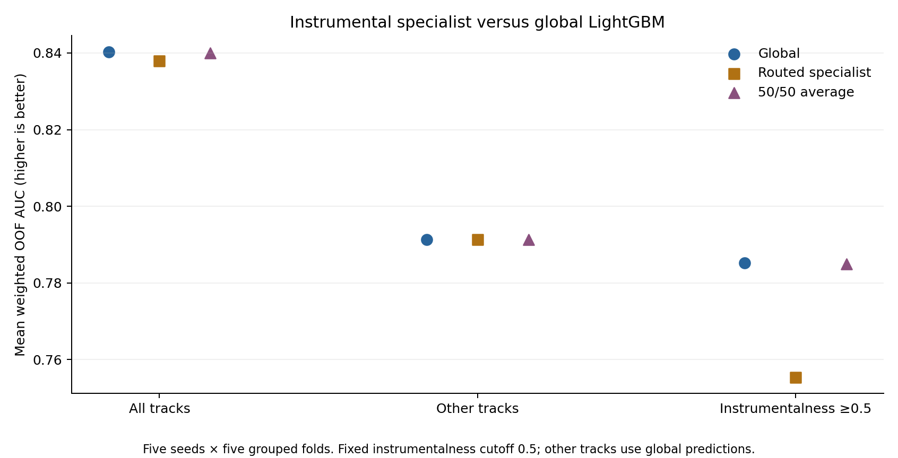

# Instrumental specialist — November 1, 2026

The LightGBM instrumental specialist did not improve the current system. Its
fixed 50/50 average with the global model slightly lowered overall weighted
AUC and the four-model ensemble's weighted AUC. Instrumental High-label misses
also increased. These results do not support creating instrumental specialists
for every model in the final ensemble. Production defaults remain unchanged.



## Prespecified setup

- Specialist group: instrumentalness >=0.5. The cutoff was fixed before fitting.
- Start with LightGBM only, using the unchanged global model hyperparameters.
- Compare global probabilities with (a) specialist replacement for instrumental
  tracks and (b) the fixed 50/50 global–specialist mean for instrumental tracks.
- For every other track, including missing instrumentalness, retain the exact
  original global probability. No specialist is trained for that group.
- Five seeds, five stratified folds grouped by URI: 25 global fits and 25
  specialist fits. No cutoff, hyperparameter, blend-weight, or threshold search.
- Rebuild each specialist's date target encoding and KNN label features from
  only instrumental rows in the outer training fold. Preserve the original inner
  grouped target encoding and training KNN zero-distance exclusion conventions.
- Retain all existing training rows with URIs, including contradictory labels,
  so this experiment isolates specialization. Preserve original label-free
  full-file counts and train-plus-test audio scaling.

| Group | Training rows | Unique tracks | High-labeled rows | Test rows |
|---|---:|---:|---:|---:|
| Instrumentalness >=0.5 | 828 | 819 | 47 | 207 |
| Other/missing | 3,035 | 2,823 | 1,312 | 656 |

Each specialist training fold contains only 32–42 High-labeled rows. The earlier
42-track figure counted label-consistent unique High tracks; this run preserves
duplicates and conflicting-label rows. Those are different populations.

## Primary results

Scores are means of the five per-seed pooled out-of-fold scores. Weighted AUC
uses the existing duplicate-prevalence adjustment and is the primary metric.

| Strategy | Ordinary AUC | Weighted AUC | Weighted change | Seeds improved | Log loss |
|---|---:|---:|---:|---:|---:|
| Global | 0.856664 | 0.840284 | — | — | 0.439530 |
| Specialist on instrumental tracks | 0.852757 | 0.837949 | -0.002335 | 0/5 | 0.454985 |
| 50/50 on instrumental tracks | 0.855919 | 0.839959 | -0.000325 | 1/5 | 0.441005 |

The 50/50 average mitigates much of the specialist's loss, but does not surpass
the baseline overall. The changes are exploratory CV results, not an independent
hidden-test assessment or a significance test.

## Does the specialist help its intended subgroup?

| Strategy | Instrumental weighted AUC | Instrumental High miss rate at 0.5 | Instrumental log loss |
|---|---:|---:|---:|
| Global | 0.785214 | 87.66% | 0.169228 |
| Specialist replacement | 0.755386 | 92.34% | 0.241333 |
| 50/50 average | 0.784887 | 91.49% | 0.176110 |

The specialist is not solving the intended High-label failure mode. The 50/50
average increases its miss rate by about 3.83 percentage points. These rates are
averages of row-level false-negative rates over five seeds, not counts of unique
tracks wrong in all 18 predictions from the earlier diagnostic. The small positive
pool makes specialization risky, but this experiment does not isolate sample size
as the cause or rule out other model settings.

Other tracks' raw OOF and test probabilities are unchanged exactly. Rankings
across instrumental and other tracks can still change. Instrumental High versus
other Low weighted pairwise AUC falls from 0.336827 to 0.272478 for the 50/50
average (0.190947 for specialist replacement). Other High versus instrumental
Low improves from 0.988406 to 0.992585 (0.993760 for replacement). Gains on the
large negative subgroup do not compensate for losses on positive instrumental
examples. Pair metrics, including within-group comparisons, are saved separately.

## Effect on the final four-model blend

Keep weights at 0.25 on the LightGBM strategy, ExtraTrees, base CatBoost, and
tuned XGBoost. Other models' predictions remain from
`../knn_musical_2026_11_01/audio/`. Average each model's probabilities across five
seeds, rank those averages using `rankdata(p)/len(p)`, and average the four ranks.

| LightGBM component | Ordinary blend AUC | Weighted blend AUC | Weighted change |
|---|---:|---:|---:|
| Global | 0.863475 | 0.847765 | — |
| Specialist replacement on instrumental tracks | 0.862929 | 0.847417 | -0.000348 |
| 50/50 on instrumental tracks | 0.863280 | 0.847633 | -0.000132 |

This uses AUC of blended seed-averaged predictions, not the mean per-seed AUC
in the first table. Absolute values must not be compared between those
aggregation methods. Rank normalization may change final rank scores for other
tracks despite their unchanged raw LightGBM probabilities.

Neither variant improves this fixed ensemble. The evidence does not justify
multiplying the same specialist design across all models. A different family
could behave differently, but that is an untested hypothesis. Keep the baseline
and save these results as a negative experiment.

## Reproduce and inspect

From the repository root using the existing isolated environment:

```powershell
.venv/Scripts/python.exe -m unittest discover -s final_pipeline -p test_period_specialists.py -v
.venv/Scripts/python.exe final_pipeline/try_period_specialists.py --specialization instrumental --threads 6 --out final_pipeline/experiments/instrumental_specialist_rerun
```

The shared runner retains its release-period behavior by default or with
`--specialization period`. It refuses to overwrite an experiment with metadata.
`metadata.json` records the fixed setup, source hashes, and starting commit.
Per-seed OOF/test predictions, fold membership, cohort metrics, pair comparisons,
fit sizes, training log, and six submission files are saved. The fixed-blend check
is recorded in `fixed_blend_comparison.csv` using the calculation above. Candidate
submissions are experimental artifacts; none replaced existing defaults.

Three tests passed, covering cutoff boundaries, missing-value fallback,
preservation of noninstrumental predictions, and weighted pairwise calculations
with ties. Independent rank AUC and direct log-loss calculations match all 45
cohort/seed scores; all 60 pair blocks match sklearn and reconcile with overall
weighted AUC. Global predictions reproduce the previous baseline to 1e-14.
Flipping every excluded label leaves the specialist feature matrices unchanged
in the checked first fold. Group boundaries, unchanged other-track probabilities,
averaging identities, source hashes and submissions were checked. The figure was
visually inspected. Details are in `validation.json`.
