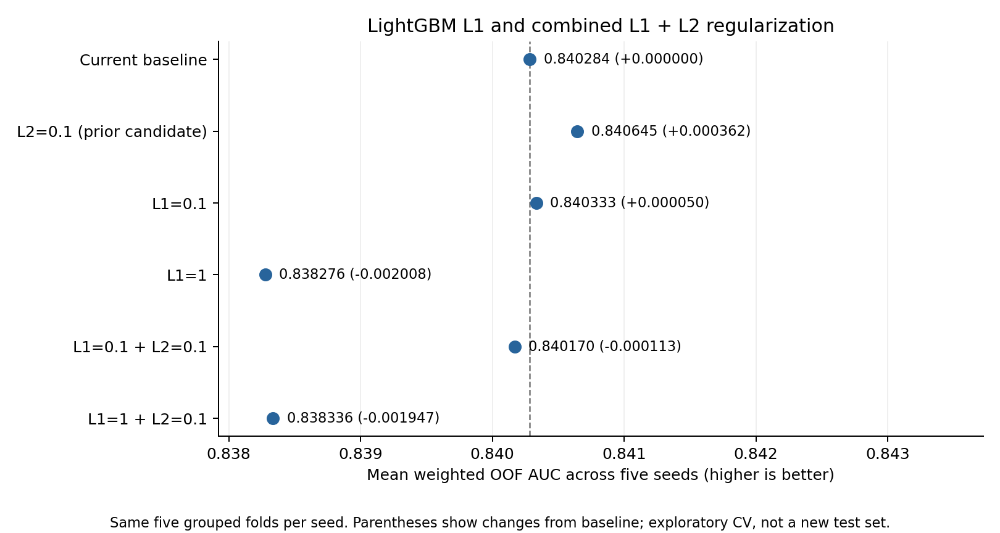

# L1 and combined L1 + L2 experiment — November 1, 2026

None of the four new L1 variants beat the previous L2=0.1 candidate on the
primary validation metric. All four also lowered the fixed-weight blend's
weighted AUC relative to the original baseline. Keep the current default;
L2=0.1 remains a tentative candidate from the earlier experiment, not a promoted
production setting.



## Controlled experiment

Six configurations use the same five seeds (0–4), five stratified folds grouped
by track URI, audio-only KNN features, and model random seeds: 150 fits in total.
Tree structure, learning rate, iterations, sampling, and all other parameters
remain fixed. Only `reg_alpha` and/or `reg_lambda` change. The original baseline
uses L1=0.001588889 and L2=0.002915878; the L2-only reference retains baseline L1.
The previously declared selection metric remains mean per-seed weighted OOF
AUC, using the original duplicate-prevalence adjustment.

| Configuration | Weighted OOF AUC | Change vs original baseline | Seeds beating original baseline |
|---|---:|---:|---:|
| Original baseline | 0.840284 | — | — |
| L2=0.1, baseline L1 | 0.840645 | +0.000362 | 3/5 |
| L1=0.1, baseline L2 | 0.840333 | +0.000050 | 3/5 |
| L1=1, baseline L2 | 0.838276 | -0.002008 | 0/5 |
| L1=0.1 + L2=0.1 | 0.840170 | -0.000113 | 3/5 |
| L1=1 + L2=0.1 | 0.838336 | -0.001947 | 0/5 |

Mild L1 was effectively tied with the original baseline as a standalone model.
The combined mild penalties won on three seeds but still lost on average: the
magnitude of losses matters as well as the number of wins. Stronger L1 lowered
the training–validation gap from 0.112983 to about 0.072, while worsening
validation AUC. A smaller gap alone is therefore not an improvement.

The exact metrics, ordinary AUC, log loss, training scores, gaps, and seed-wise
changes are retained in `summary.csv`, `seed_metrics.csv`, and `fold_metrics.csv`.
These findings concern the tested settings, not L1 regularization in general.

## Fixed-weight blend check

Hold weights at 0.25 each on LightGBM, ExtraTrees, base CatBoost, and tuned
XGBoost. Keep the other three models' predictions from
`../knn_musical_2026_11_01/audio/` and replace only LightGBM. For each model,
average probabilities across five seeds, rank those means as
`rankdata(p)/len(p)`, and average the four ranked vectors.

| LightGBM setting in blend | Weighted AUC | Change vs original blend | Change vs L2-only blend |
|---|---:|---:|---:|
| Original baseline | 0.847765 | — | -0.000068 |
| L2=0.1 | 0.847833 | +0.000068 | — |
| L1=0.1 | 0.847742 | -0.000023 | -0.000091 |
| L1=1 | 0.847115 | -0.000650 | -0.000718 |
| L1=0.1 + L2=0.1 | 0.847679 | -0.000085 | -0.000153 |
| L1=1 + L2=0.1 | 0.847197 | -0.000568 | -0.000636 |

This is AUC of the blend of seed-averaged predictions, **not** the mean per-seed
AUC in the first table. Absolute scores from those two aggregation methods
must not be compared directly. All weights are fixed; no blend weight search
was performed. `fixed_blend_comparison.csv` contains full-precision results.

## Interpretation and limits

No new candidate justifies replacing the baseline. Mild L1 has negligible
standalone benefit and a negligible negative blend effect. Larger L1 is too
restrictive under these fixed model settings. The earlier L2-only gain remains
small and exploratory. Repeatedly selecting among configurations on the same
dataset risks validation overfitting. Folds and seeds reuse observations, so
win counts are descriptive rather than independent significance tests. These
are CV results, not newly measured leaderboard scores or an untouched test set.
No production model parameters or prior submissions were changed.

## Reproduce and inspect

From the repository root with the existing environment:

```powershell
.venv/Scripts/python.exe final_pipeline/try_gentle_regularization.py --suite l1_l2 --threads 6 --out final_pipeline/experiments/l1_l2_regularization_rerun
```

The existing gentle suite remains available with `--suite gentle` (the default).
The script refuses to overwrite a directory containing experiment metadata.
`metadata.json` records exact configurations, seeds, source hashes, and the
starting commit. `predictions.npz` preserves per-seed OOF and test predictions;
all six standalone and six fixed-blend submissions are saved as separate files.
The fixed-blend calculation above is recorded separately from the training run.

Validation confirmed 150 fits, 30 seed scores, correct group boundaries and
prediction ranges, and submission IDs/order. Independent rank-sum AUC and
recomputed weighted AUC agree with all seed scores. Baseline and L2-only OOF
and test predictions reproduce the previous experiment to 1e-14. Source/input
hashes match, and every non-penalty model parameter is identical across this
suite. The chart was visually inspected. See `validation.json`.
