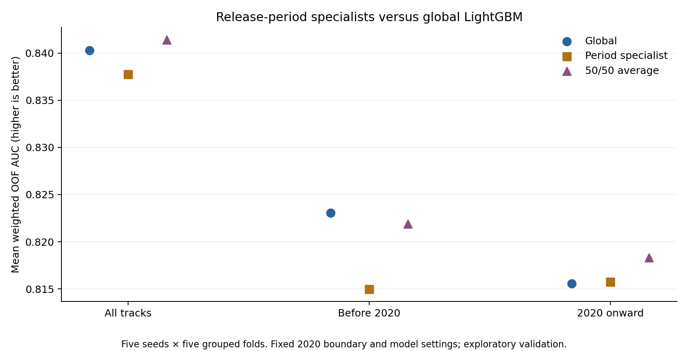

# Release-period specialists — November 1, 2026

The fixed 50/50 average of global LightGBM and the appropriate release-period
specialist improved overall weighted OOF AUC on all five seeds. Specialists
alone were worse on every seed. The averaging strategy is a promising candidate,
but it trades a small loss on older tracks for stronger ranking of recent tracks,
and does not materially reduce recent High-labeled classification misses.
No production defaults or previous submissions were changed.



## Prespecified experiment

- Periods: before 2020 and 2020 onward. The boundary was fixed before evaluation.
- Models: global LightGBM plus one specialist per period, all using the unchanged
  parameters from `final_pipeline/tuned_lgb.json`.
- Strategies: global alone, routed specialist alone, or the fixed arithmetic mean
  of global and routed-specialist probabilities. No blend-weight tuning.
- Five seeds (0–4), five stratified folds grouped by URI, 75 fits total.
- Each specialist's date target encoding and KNN label features were rebuilt from
  only that period's outer training rows. Inner date target encoding remains
  grouped and out of fold; training KNN retains zero-distance exclusion.
- Label-free counts and train-plus-test audio scaling retain the original pipeline
  conventions. These are transductive feature conventions, not held-out labels.
- Every variant retains all 3,863 training rows with a URI, including the conflicting
  labels identified earlier. A missing/unparseable release year falls back to the
  global model; no such dates occur in this run.

| Period | Training rows | Unique tracks | High rows | Test rows |
|---|---:|---:|---:|---:|
| Before 2020 | 1,483 | 1,391 | 752 | 310 |
| 2020 onward | 2,380 | 2,251 | 607 | 553 |

These populations retain conflicting-label URIs, unlike the earlier unique-track
error diagnostic. Each outer fold trains on approximately 80% of these rows.

## Overall results

These are means of the five per-seed pooled OOF scores. Weighted AUC uses the
existing duplicate-prevalence adjustment, declared as the primary metric.

| Strategy | Ordinary AUC | Weighted AUC | Weighted change vs global | Seeds improved | Log loss |
|---|---:|---:|---:|---:|---:|
| Global | 0.856664 | 0.840284 | — | — | 0.439530 |
| Period specialist | 0.853787 | 0.837745 | -0.002539 | 0/5 | 0.446751 |
| 50/50 global + specialist | 0.857388 | 0.841416 | +0.001132 | 5/5 | 0.439520 |

The average's ranking improvement is modest and consistent across the reused
splits. Log loss is essentially unchanged. This supports using specialization
as an additional source of predictions rather than replacing the global learner.
It does not establish a gain on an untouched test set.

## Within-period performance and recent High misses

| Strategy | Before-2020 weighted AUC | 2020-onward weighted AUC | Recent High miss rate at 0.5 |
|---|---:|---:|---:|
| Global | 0.823072 | 0.815568 | 54.27% |
| Period specialist | 0.814971 | 0.815741 | 54.43% |
| 50/50 average | 0.821891 | 0.818343 | 54.50% |

The average improves recent-period weighted AUC by 0.002775 on average and wins
on all five seeds within that cohort. Older-period AUC decreases by 0.001182,
also consistently across all seeds. The recent High miss rate slightly worsens
by about 0.23 percentage points. It measures the mean row-level false-negative
rate across five OOF runs at cutoff 0.5; it is not the earlier count of tracks
wrong in all 18 predictions. AUC improvement does not imply better thresholded
classification or that the hardest named tracks are fixed.

Overall AUC is not a weighted average of within-period AUCs: it also includes
comparisons between tracks from different periods.

## Cross-period score compatibility

Each cell is the mean weighted fraction of correctly ordered positive/negative
pairs from the indicated periods, with ties receiving half credit.

| High-labeled period / Low-labeled period | Global | Specialist | 50/50 average |
|---|---:|---:|---:|
| Before 2020 / Before 2020 | 0.823072 | 0.814971 | 0.821891 |
| 2020 onward / 2020 onward | 0.815568 | 0.815741 | 0.818343 |
| Before 2020 / 2020 onward | 0.933664 | 0.935356 | 0.936952 |
| 2020 onward / Before 2020 | 0.618251 | 0.602862 | 0.611502 |

Recent High tracks versus older Low tracks remain particularly difficult, and
specialization worsens that comparison even after averaging. The average gains
enough on other pair types to improve overall AUC. Its cross-period scores should
not be treated as uniformly improved or as calibrated probabilities. The pair
blocks reconcile exactly to overall weighted AUC when weighted by pair mass.

## Existing four-model blend

For a downstream check, hold the other components and weights fixed at 0.25 each:
LightGBM strategy, ExtraTrees, base CatBoost, and tuned XGBoost. Average each
component's probabilities across five seeds, rank the averages, and average those
four ranked vectors. The other components come from
`../knn_musical_2026_11_01/audio/`; only the LightGBM component changes.

| LightGBM component | Ordinary blend AUC | Weighted blend AUC | Weighted change |
|---|---:|---:|---:|
| Global | 0.863475 | 0.847765 | — |
| Period specialist | 0.863643 | 0.848118 | +0.000353 |
| 50/50 average | 0.863676 | 0.848064 | +0.000299 |

These values use **AUC of blended seed-averaged predictions**, not mean per-seed
AUC, and must not be compared directly with the earlier absolute scores.
Specialists can provide useful complementary predictions despite being weaker
alone. The two downstream gains are small, and their difference is too small to
justify confidently choosing one as a new default.

## Recommendation and limits

Keep the 50/50 strategy as a candidate based on the prespecified primary
comparison, and retain both specialist-based full-blend submissions for review.
The results do not yet justify finer period splits or period-specific tuning.
The older specialist's poorer results are consistent with the smaller training
pool, but this experiment does not isolate the cause. Reused observations and
previous feature/model selection make all results exploratory; seed win counts
are descriptive, not an independent significance test. No hidden test labels,
new leaderboard feedback, threshold search, or label repairs were used.

## Reproduce and inspect

From the repository root with the existing environment:

```powershell
.venv/Scripts/python.exe -m unittest discover -s final_pipeline -p test_period_specialists.py -v
.venv/Scripts/python.exe final_pipeline/try_period_specialists.py --threads 6 --out final_pipeline/experiments/period_specialists_rerun
```

The script refuses to overwrite a completed experiment's metadata. Exact
parameters, source hashes and the starting commit are in `metadata.json`.
`predictions.npz` stores per-seed OOF and test predictions. Cohort metrics, pair
metrics, fit sizes, fold membership, summaries, and logs are saved. The downstream
fixed-blend check is saved separately in `fixed_blend_comparison.csv` using the
calculation above. Candidate files include:

- `submission_half_global_half_specialist.csv`: the 50/50 LightGBM strategy.
- `submission_fixed_blend_half_global_half_specialist.csv`: its four-model blend.
- `submission_fixed_blend_specialist.csv`: specialist replacement in the four-model blend.

Two unit tests cover routing boundaries, missing-date fallback, ties and weighted
pairwise decomposition. Independent rank-sum AUC and direct log loss calculations
match all 45 cohort/seed metrics. All 60 pair blocks match sklearn calculations and
reconcile with overall AUC. Global OOF/test predictions reproduce the earlier
baseline to 1e-14. Flipping every excluded label leaves specialist feature matrices
unchanged for both regions in the first fold. Group boundaries, averaging identities,
six submission files and source hashes were checked. The chart was visually
inspected. See `validation.json` for the check record.
