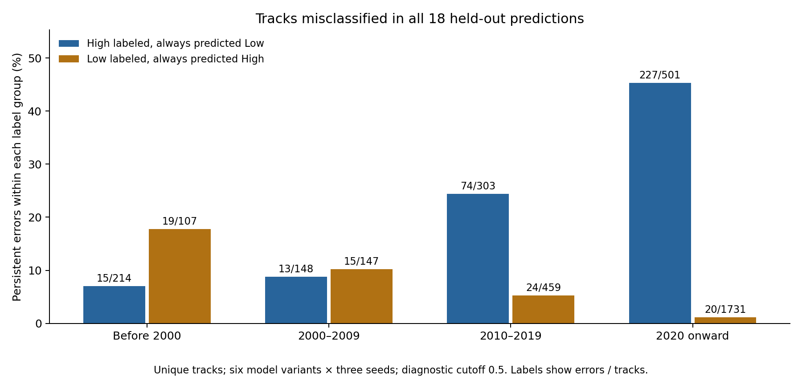

# Consistently misclassified tracks — November 1, 2026

407 of 3,610 label-consistent unique tracks are misclassified in every saved prediction (six original model variants × three seeds). Of these, 329 are labeled High and 78 Low. Forty-six have probability assigned to their true class at most 0.2 in every prediction. These are errors relative to the assignment labels, not an assessment of current real-world popularity.



## Named examples

Mean P(High) below is the arithmetic mean of 18 model outputs, not a calibrated certainty or the final rank-blend score. Each listed example is wrong in all 18 predictions at the diagnostic 0.5 cutoff. Metadata comes from exact-URI Spotify lookups on November 1, 2026, solely to identify tracks.

| Track | Artist(s) | Dataset label | Mean predicted P(High) | Original CSV line(s) |
|---|---|---|---:|---|
| [Touches](https://open.spotify.com/track/6KzdWw8Hi1bz1lVw2AXDzb?utm_source=openai&utm_medium=chatgpt&go=1&nap_web=1&request_id=d46d9dc0-3c4e-494c-9aa3-409ba2690d83) | Somnum Magnam | High | 0.59% | 351 |
| [Experience](https://open.spotify.com/track/1BncfTJAWxrsxyT9culBrj?utm_source=openai&utm_medium=chatgpt&go=1&nap_web=1&request_id=d46d9dc0-3c4e-494c-9aa3-409ba2690d83) | Ludovico Einaudi, Daniel Hope, I Virtuosi Italiani | High | 1.08% | 552 |
| [LOVELY BASTARDS](https://open.spotify.com/track/0EqczV3o6fwksegAavIHpX?utm_source=openai&utm_medium=chatgpt&go=1&nap_web=1&request_id=d46d9dc0-3c4e-494c-9aa3-409ba2690d83) | ZWE1HVNDXR, yatashigang | High | 2.31% | 1968 |
| [Behind Every Decision](https://open.spotify.com/track/2kbruQXVXFmxxm4l75zuwy?utm_source=openai&utm_medium=chatgpt&go=1&nap_web=1&request_id=d46d9dc0-3c4e-494c-9aa3-409ba2690d83) | Yehezkel Raz | High | 3.01% | 1547 |
| [Breathe](https://open.spotify.com/track/5NAOhPAZ57eFAXr3qatS6i?utm_source=openai&utm_medium=chatgpt&go=1&nap_web=1&request_id=d46d9dc0-3c4e-494c-9aa3-409ba2690d83) | Yeat | High | 3.13% | 488 |
| [I'm Shipping Up To Boston](https://open.spotify.com/track/7rSERmjAT38lC5QhJ8hnQc?utm_source=openai&utm_medium=chatgpt&go=1&nap_web=1&request_id=d46d9dc0-3c4e-494c-9aa3-409ba2690d83) | Dropkick Murphys | Low | 92.23% | 128,581 |
| [Full Clip](https://open.spotify.com/track/30oTS7bm0aH3p7lqjEIu8q?utm_source=openai&utm_medium=chatgpt&go=1&nap_web=1&request_id=d46d9dc0-3c4e-494c-9aa3-409ba2690d83) | Gang Starr | Low | 88.43% | 106 |
| [Kumama Papa](https://open.spotify.com/track/5LwT1tPiIUszQ7C51DuEL2?utm_source=openai&utm_medium=chatgpt&go=1&nap_web=1&request_id=d46d9dc0-3c4e-494c-9aa3-409ba2690d83) | Grace Lokwa, Moses Bliss, Prinx Emmanuel | Low | 88.57% | 479,1242 |
| [That's What You Get](https://open.spotify.com/track/1JdKrFyoU05abww0Zv0ayQ?utm_source=openai&utm_medium=chatgpt&go=1&nap_web=1&request_id=d46d9dc0-3c4e-494c-9aa3-409ba2690d83) | Paramore | Low | 87.23% | 3608 |
| [Kerosene](https://open.spotify.com/track/2yhhcHTfvLC0HzSajGYL0h?utm_source=openai&utm_medium=chatgpt&go=1&nap_web=1&request_id=d46d9dc0-3c4e-494c-9aa3-409ba2690d83) | Miranda Lambert | Low | 86.67% | 3762 |

The most severe examples are genuine ranking problems as well as threshold errors. Under the mean rank across all 18 predictors, Touches ranks below about 98.9% of Low-labeled tracks; Experience ranks below about 94.9%. Full rankings and opposite-class pairwise error fractions are in `all_tracks.csv`.

## Patterns worth testing

- Recent High-labeled tracks: 227/501 (45.3%) released from 2020 onward are persistent misses, versus 15/214 (7.0%) before 2000. Conversely, 19/107 (17.8%) older Low-labeled tracks are persistent false positives, versus 20/1,731 (1.2%) recent Low-labeled tracks. Release-period label distributions differ, so this is a descriptive pattern rather than proof of a harmful date feature.
- Instrumentalness: 30/42 (71.4%) High-labeled tracks with instrumentalness >=0.5 are persistent misses, versus 299/1,124 (26.6%) below 0.5. There are 776 Low-labeled tracks in the high-instrumentalness group and none is a persistent false positive. This is a small positive subgroup with a strong competing base-rate signal; blindly removing the feature could hurt the majority.
- Multiplicity: 328/1,023 (32.1%) single-row High-labeled tracks are persistent misses versus 1/143 (0.7%) repeated High-labeled tracks. Repeated Low-labeled tracks are harder (5/28 persistent errors); the denominator is small.
- Same-date KNN coverage is not a simple explanation: High-labeled tracks with some date-neighbor coverage have a 28.8% persistent error rate versus 26.9% for tracks with no same-date training neighbors across all three splits.
- Within the High label, persistent misses have median acousticness 0.245 versus 0.0973 for the rest, median energy 0.636 versus 0.704, and loudness -7.18 versus -5.692. These unadjusted associations are exploratory and may reflect release-period or other differences.

The rest of a label group includes both always-correct and inconsistently classified tracks. Segment groups overlap and must not be summed. `segments.csv` provides denominators and threshold-free ranking error summaries.

## Conflicting labels: a separate data-quality finding

32 distinct URIs occur with both High and Low labels, spanning 66 rows. Every original input field is identical within each such URI. A deterministic prediction from these inputs cannot classify all contradictory rows correctly. Missing collection-time or other context could explain the inconsistency; this does not establish which label is correct. No rows or labels were changed. These tracks were excluded only from the unique-track diagnostic, and saved separately.

Examples with exact Spotify identifiers:
- [ROCKMAN](https://open.spotify.com/track/63ABAnFKJCp28TAyqf2cGL?utm_source=openai&utm_medium=chatgpt&go=1&nap_web=1&request_id=d46d9dc0-3c4e-494c-9aa3-409ba2690d83) — CSV line 10: High, CSV line 3119: Low.
- [Hold On Me](https://open.spotify.com/track/4aPX3IT9cskOWmeZvOYc5s?utm_source=openai&utm_medium=chatgpt&go=1&nap_web=1&request_id=d46d9dc0-3c4e-494c-9aa3-409ba2690d83) — CSV line 48: High, CSV line 1658: Low.
- [La Zona](https://open.spotify.com/track/5kqNIqFjijuzvVLhuY9B8j?utm_source=openai&utm_medium=chatgpt&go=1&nap_web=1&request_id=d46d9dc0-3c4e-494c-9aa3-409ba2690d83) — CSV line 157: Low, CSV line 2519: High.

See `conflicting_labels.csv` for all original rows and `conflict_summary.csv` for class counts and exact-input checks. The 32 contradictory URIs do not explain the other 407 persistent errors; these populations are disjoint.

## What to do next

First review how the labels were constructed and the contradictory rows. Do not automatically relabel a track based on model consensus or its current Spotify identity. Then run a targeted feature ablation of release-date and multiplicity features, checking both overall AUC and these subgroup errors. Instrumentalness-dependent interactions are another hypothesis, but the instrumental High subgroup has only 42 tracks, so targeted tuning there could easily overfit. PCA remains an experiment rather than an established remedy for these patterns.

## Method, limitations, and reproducibility

- Source: saved group-held-out predictions from `../bias_variance_2026_11_01/`, models lgb_tuned, lgb_deep, xgb_tuned, cat_tuned, cat_base, extra_trees, seeds 0–2. The extra regularized probe is excluded. No new models were trained.
- Repeated rows are averaged within URI/model/seed, so each label-consistent URI contributes once. Identical URI groups stayed entirely out of the training fold for their predictions.
- High is predicted when P(High) >=0.5. This cutoff is diagnostic, not optimized; lowering it could change error counts without improving AUC. The 18 predictions are correlated and are not independent confidence assessments.
- A separate score averages per-predictor ranks across the 3,610 unique tracks. For each track we count the proportion of opposite-class tracks outranking it incorrectly, with half credit for ties. This reproduces unique-track consensus AUC 0.854985. It differs in population and aggregation from earlier row-level weighted blend AUCs.
- Original CSV lines are one-based, including the header; source_row uses the cleaned training index used by the stored predictions.
- Spotify metadata contains names, creators, albums, and exact returned links for ten difficult examples and three conflicting-label examples. It adds no popularity labels and was not used as model input. Ten additional hard-example IDs remain unnamed in the top-20 table.
- Repeated model selection on this dataset makes these exploratory diagnostics, not an independent assessment of future performance.

Run from the repository root:

```powershell
.venv/Scripts/python.exe final_pipeline/analyze_track_errors.py
```

The script recomputes diagnostics and uses the saved metadata when available. Full source fingerprints and counts are in `summary.json`; direct example checks, CSV-line checks, and the independent AUC reconciliation are recorded in `validation.json`. The chart was visually inspected.
